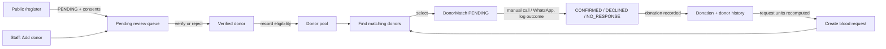
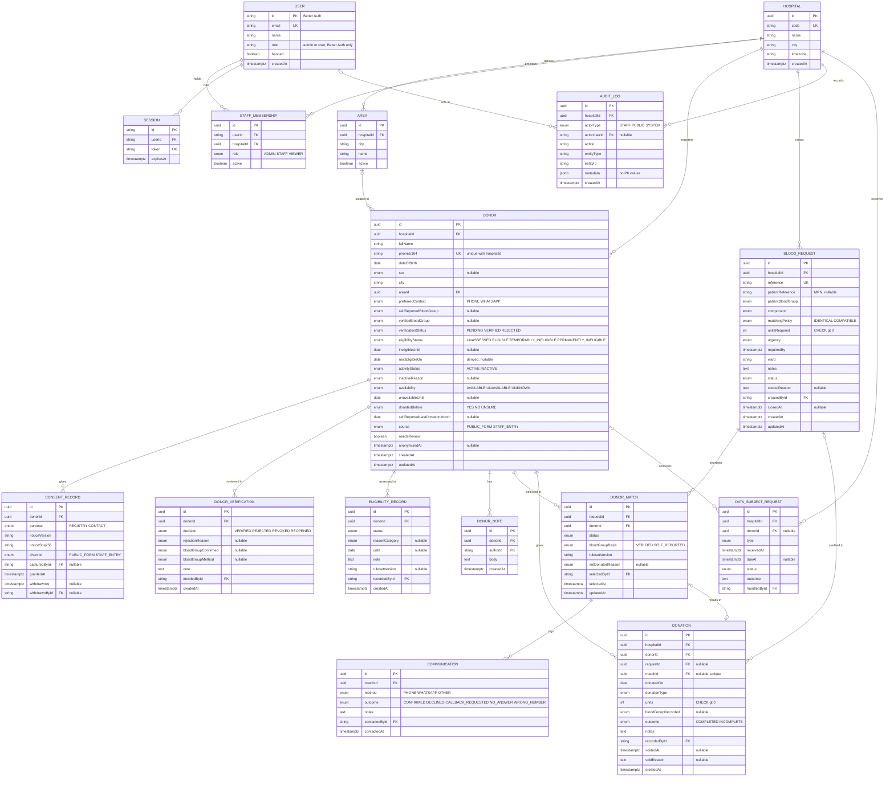
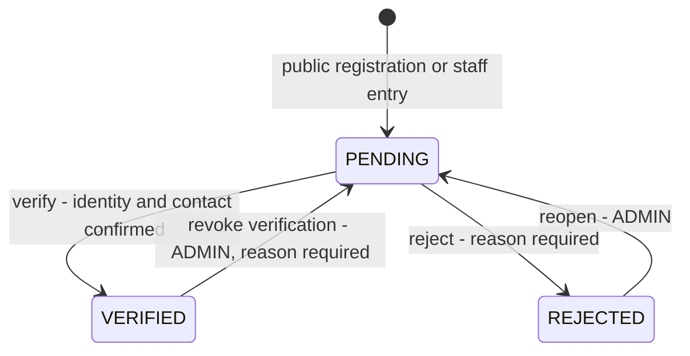
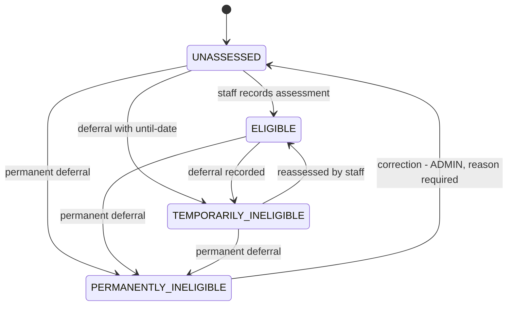
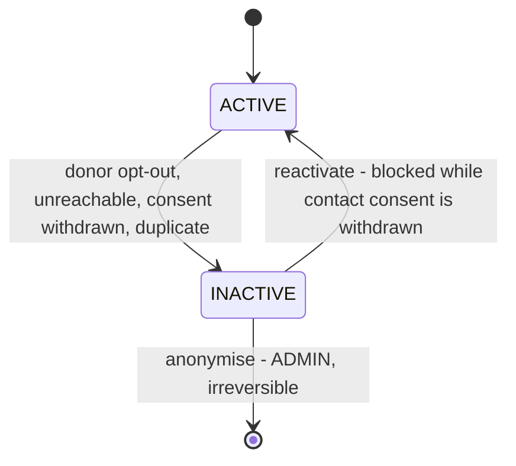
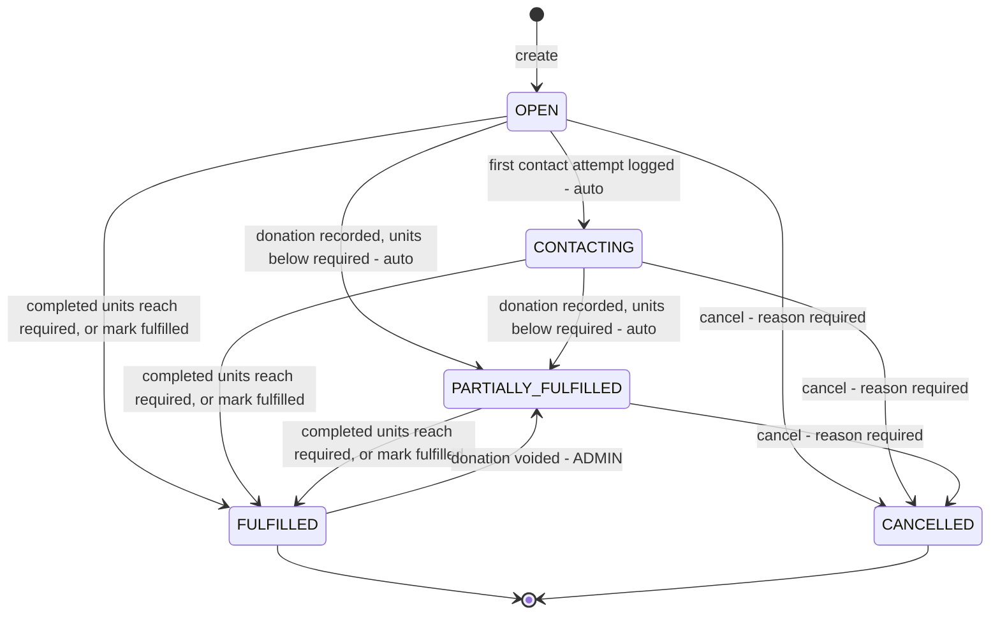
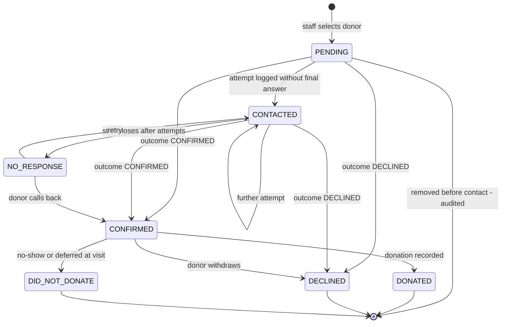

# Building Queseir's Donor Registry: MVP Technical Specification

The Queseir Hospital Blood Bank MVP can be built as a single Next.js 16 application on PostgreSQL 18 with Prisma 7, Better Auth 1.7 and Zod 4. Every read and write goes through a server-only data access layer (DAL) that checks authorization, and three independent donor status fields keep verification, eligibility and activity apart. The hard problems sit outside the code. First, blood compatibility depends on the requested component, and published Egyptian donor criteria disagree with each other. The system therefore ships with **matching blocked until the blood bank approves a versioned medical ruleset**, and it contains no built-in compatibility table or donation interval. Second, a donor's blood group, even self-reported, is **sensitive health data under Egypt's PDPL (Law 151/2020)**. That requires a PDPC licence, explicit written consent, a registered DPO, and a breach-notification capability (72 hours to the PDPC). The grace period of the PDPL Executive Regulations ends around **1 November 2026**, so this system will launch into an enforced regime. Third, none of Vercel, Neon or Supabase offers a Middle East region, and none of the major clouds checked (AWS, Azure) has an Egypt region. The Vercel + managed-Postgres setup suggested in the brief would therefore be a **cross-border transfer that needs a PDPC permit**. The architecture stays host-agnostic so the hospital can choose Egyptian hosting instead. This document follows the 15 sections requested, maps the build phases to the brief's 17-step Definition of Done, and marks every point needing a product, medical or legal answer. It is design input, not legal or medical advice.

## Key decisions at a glance

| # | Decision | Reason | Tradeoff |
|---|---|---|---|
| D1 | One Next.js 16 App Router app (UI + Server Actions + DAL), no separate backend | The brief allows it, it minimizes moving parts, and Next.js docs prescribe a DAL pattern for exactly this ([Next.js Data Security](https://nextjs.org/docs/app/guides/data-security)) | Domain logic must be kept in `src/domain` and `src/server` by convention, or it drifts into components |
| D2 | Three donor status fields (`verificationStatus`, `eligibilityStatus`, `activityStatus`) plus an `availability` attribute, not one status | The brief warns against overloading. "Verified but deferred" and "eligible but inactive" are real combinations | More fields to filter and display. Dashboard "eligible" must be a defined composite |
| D3 | Blood group stored twice: `selfReportedBloodGroup` and `verifiedBloodGroup`, with verification method recorded | Brief Rule 6. The source of a group must be explicit at match time | Matching needs a policy on self-reported groups (Medical Rule Required M5) |
| D4 | Medical rules live in a typed, versioned code-config module with approval metadata. With no APPROVED ruleset, matching refuses to run in production | Keeps rules auditable, reviewable and testable, and lets the system ship without invented values | A rule change needs a deploy. No in-app rule editor in the MVP |
| D5 | Matching returns a filtered, deterministically ordered list with per-donor reasons and no numeric score | Brief section 11. Staff must see *why* a donor is listed | Ordering is coarse (availability, then area, then recency of contact) |
| D6 | Location is a hospital-managed `Area` list. No geocoding or distance | Advanced maps are out of scope. Free-text areas make "eligible O+ in this area" unreliable | No km distance. The brief's "2.4 km" example is deferred |
| D7 | Authorization in the DAL via `requirePermission()`. `proxy.ts` only does cookie-presence redirects | Next.js docs call proxy checks "optimistic", and CVE-2025-29927 showed middleware-only auth can be bypassed ([GHSA-f82v-jwr5-mffw](https://github.com/advisories/GHSA-f82v-jwr5-mffw); [Next.js Authentication](https://nextjs.org/docs/app/guides/authentication)) | Every action and query must call it. Enforced by review checklist and tests |
| D8 | Roles are a code-defined permission map (`ADMIN`, `STAFF`, `VIEWER`) on a per-hospital `StaffMembership`. No `roles`/`permissions` tables | Three roles do not justify runtime-editable RBAC. Membership keeps multi-hospital possible later | Adding a role needs a deploy |
| D9 | Better Auth 1.7 (email + password, DB sessions, sign-up disabled, admin plugin) | Auth.js is now maintained by the Better Auth team, which steers new projects to Better Auth ([Better Auth blog](https://better-auth.com/blog/authjs-joins-better-auth)) | Fairly young library with a breaking 1.7 identity-model change. Track its advisories |
| D10 | Prisma 7 (`^7.10`), not the Prisma 8 RC | v8 is RC with GA targeted for Oct 2026, and Prisma advises v7 users to pin `^7` ([Prisma release status](https://www.prisma.io/docs/orm/release-status)) | A v8 migration comes later |
| D11 | Host-agnostic deployment (`output: 'standalone'` Node server + Postgres). Production hosting location is a legal gate | No Egypt region on Vercel, Neon, Supabase or AWS RDS ([Vercel regions](https://vercel.com/docs/regions); [Neon regions](https://neon.com/docs/introduction/regions)); foreign hosting triggers a PDPC transfer permit | Cannot assume Vercel's managed conveniences in production |
| D12 | Append-only history tables for verification and eligibility, plus an append-only `audit_log` that also records reads of donor PII | Brief Rule 12, and the PDPL's confidentiality and evidence obligations | More rows written. Read-audit volume grows with use |
| D13 | Consent stored as explicit `ConsentRecord` rows, with two separate unticked consents on the public form | The PDPL requires explicit, specific, written (incl. electronic) consent for sensitive data, with no bundling ([CMS](https://cms.law/en/int/legal-updates/egypt-s-pdpl-executive-regulations-issued-one-year-compliance-countdown-begins); [Kennedys](https://www.kennedyslaw.com/en/thought-leadership/article/2026/egypt-s-personal-data-protection-law-the-compliance-countdown-has-begun/)) | Slightly longer form. Final wording needs legal approval |
| D14 | No caching of donor or request data (`cacheComponents` off; no `"use cache"` on PII). Request-time rendering throughout | Several 2026 Next.js advisories involve cache poisoning or leaks in cache features ([Next.js Sept 2026 security release](https://nextjs.org/blog/september-2026-security-release)) | Slightly slower pages. Irrelevant at single-hospital scale |

## 1. Product summary: a staff-operated recall tool, not a medical record

The system is an internal operational tool for the Queseir Hospital Blood Bank. It keeps a registry of people willing to donate, lets staff review and verify them, tracks staff-recorded eligibility and availability, and supports the recall loop when blood is needed: request → shortlist → manual contact → outcome → donation record. A separate public, mobile-first `/register` page (reachable by QR code) feeds registrations into the application database as `PENDING`. The application database, not a Google Sheet, is the source of truth. The system does not screen donors clinically, does not hold lab results or haemoglobin and vital signs (those belong to the donation visit, per WHO's separation of registry from visit assessment ([WHO 2012, ch. 4](https://www.ncbi.nlm.nih.gov/books/NBK138219/))), does not manage inventory or bags, and does not send messages automatically. It records decisions that humans make, under rules that the blood bank supplies.

Two domain facts shape the model. Egyptian hospital banks have historically relied on family/replacement donation: at Ain Shams University Hospital, **87.7% of donors were replacement donors** ([Blood Transfusion 2014](https://www.bloodtransfusion.it/public/pre2018archives/2014/BloodTransfus2014_Vol12_Issue_2_159-165_115-12.pdf)). Collected units also enter stock after testing; they are not transfused directly to a named patient. A "blood request" is therefore modelled as a *need*, and a donation recorded against it is an operational credit, not a claim that the patient received that unit. Separately, Egyptian NBTS donations are separated into components ([WHO EMRO 2016](https://applications.emro.who.int/docs/EMROPub_2017_EN_18907.pdf)), and ABO/RhD compatibility differs by component (O is the universal red-cell donor, AB the universal plasma donor ([Lifeblood](https://www.lifeblood.com.au/health-professionals/products/component-compatibility))). A request therefore records the component, and compatibility is looked up per component in the approved ruleset.

The MVP serves one hospital, but every operational row carries `hospitalId`, sourced from the authenticated user's membership and never from client input. A second hospital later becomes a data and admin-UI change, not a schema rewrite.

## 2. User roles: one anonymous public actor, three staff roles

| Actor | Account | Purpose |
|---|---|---|
| Public donor | None | Submits the `/register` form and reads the privacy notice. Never sees dashboard data. Is recorded as `actorType = PUBLIC` in audit |
| `ADMIN` | Staff (Better Auth) | Blood-bank lead. Everything STAFF can do, plus user management, settings, full audit log, data-subject requests (export or anonymise), corrections (voiding donations, reverting terminal states) |
| `STAFF` (coordinator) | Staff | Day-to-day operator: reviews and verifies donors, records eligibility, creates requests, runs matching, contacts donors, records donations |
| `VIEWER` | Staff | Read-only operational view (e.g. hospital management): dashboard, lists with masked contact details, request status. No PII reveal, no writes |

**Technical Decision:** role lives on `StaffMembership(userId, hospitalId, role)`. Better Auth's admin-plugin role is kept to `admin`/`user` only to gate Better Auth's own user-management endpoints, and the staff service sets it from the membership role. *Tradeoff:* two role fields must stay in sync. One service owns both writes, and an integration test asserts consistency. **Open Question O12:** should eligibility changes be restricted to a medically qualified role (e.g. blood-bank physician)? Until answered, STAFF holds `donor:set_eligibility`.

## 3. Core workflows: registration to donation history in nine flows



**W1 Public registration.** The donor opens `/register`, fills the minimal form (full name, Egyptian mobile number, date of birth, self-reported blood group or "don't know", city, area from list, donated before Y/N/unsure, approximate last donation month, preferred contact method) and ticks two separate, unticked consents: (a) storing and processing their data, including health data, for the donor registry; (b) being contacted about donation needs. Server-side Zod validation runs, a throttle applies (per hashed IP), and a honeypot field catches bots. One transaction creates `Donor` (`PENDING`/`UNASSESSED`/`ACTIVE`, `source = PUBLIC_FORM`), two `ConsentRecord`s and an audit entry. The confirmation screen reveals nothing about existing records. If the phone number already exists for the hospital, the same confirmation is shown, the existing donor is flagged `needsReview`, and a `donor.registration_resubmitted` audit event is written. This avoids revealing who is registered. Under-18 submissions are rejected (Law 8/2021 Art. 15 bars donation by children ([Law 8/2021](https://www.edaegypt.gov.eg/media/yxgdsayq/law-no-8.pdf)); the exact minimum age is M3).

**W2 Staff entry.** STAFF creates a donor from the dashboard (walk-in or paper form). Consent is captured with `channel = STAFF_ENTRY`, and the staff user is recorded as the capturer. A "verify now" option runs W3 straight away as a second, separately audited step.

**W3 Review and verification.** The Pending Review queue lists `PENDING` and `needsReview` donors. STAFF confirms identity and contact (typically by phone) and then either **verifies** or **rejects** with a reason category (duplicate, unreachable, invalid, does not meet registration criteria, other). Blood-group verification is a separate, optional part of the same dialog. Staff record the confirmed group and the method (from a list the blood bank approves, M6), which sets `verifiedBloodGroup`. Every decision appends a `DonorVerification` row.

**W4 Eligibility management.** STAFF records an assessment: `ELIGIBLE`, `TEMPORARILY_INELIGIBLE` (with until-date and reason category), or `PERMANENTLY_INELIGIBLE` (reason category). Each change appends an `EligibilityRecord`. The system does not compute eligibility from health answers. If, and only if, an approved donation-interval rule exists, recording a donation also sets a derived `nextEligibleOn`, which matching respects (see section 8).

**W5 Blood request lifecycle.** STAFF creates a request with patient blood group, component, matching policy (identical or compatible), units, urgency, required-by time, ward/location, an optional patient reference (MRN, never a name), and notes. Status changes as described in section 6.

**W6 Matching and selection.** From the request page, the primary action is **Find matching donors**. The matching service returns eligible candidates with reasons and warnings, and STAFF selects donors, which creates `DonorMatch` rows in `PENDING`.

**W7 Outreach.** STAFF contacts donors outside the system (phone or WhatsApp; no APIs) and logs each attempt as a `Communication` (method, outcome, notes, who, when). Outcomes drive match transitions. The first attempt on a request moves it to `CONTACTING`.

**W8 Donation recording.** When a confirmed donor attends, STAFF records a `Donation` (date, type, units, recorded group if known, outcome `COMPLETED`/`INCOMPLETE`, notes) linked to donor, match and request. The match becomes `DONATED`. Request fulfilment is recomputed in the same transaction, and the donation appears in the donor's history. If a confirmed donor no-shows or is deferred at the visit, the match becomes `DID_NOT_DONATE` with a reason, and any deferral is recorded through W4.

**W9 Consent withdrawal and data-subject requests.** A donor may withdraw consent (by phone or in person). STAFF records it, which immediately sets `activityStatus = INACTIVE` (reason `CONSENT_WITHDRAWN`) and excludes the donor from matching. ADMIN handles access requests (JSON/CSV export of that donor's data), corrections (edit), and erasure (irreversible anonymisation that keeps donation rows for the retention period). Each request is logged in `DataSubjectRequest`.

## 4. Entity model: fifteen explicit tables, no JSON-blob domain data

| Entity | Purpose | Key fields and constraints |
|---|---|---|
| `Hospital` | Tenant boundary (one row in the MVP) | `code` unique, `timezone` (`Africa/Cairo`) |
| `Area` | Hospital-managed locality list for filtering and match ordering | unique `(hospitalId, city, name)`, `active` |
| `User`, `Session`, `Account`, `Verification` | Better Auth tables, generated by its CLI | Email unique. DB-backed sessions |
| `StaffMembership` | User ↔ hospital with role | unique `(userId, hospitalId)`, `role` enum, `active` |
| `Donor` | Identity, contact, blood info, current statuses | unique `(hospitalId, phoneE164)`. `verificationStatus`, `eligibilityStatus`, `activityStatus`, `availability` enums. `selfReportedBloodGroup?`, `verifiedBloodGroup?`. `nextEligibleOn?` (derived). `anonymisedAt?` |
| `ConsentRecord` | Evidence of each consent | `purpose` (`REGISTRY`, `CONTACT`), `noticeVersion`, `noticeSha256`, `channel`, `grantedAt`, `withdrawnAt?`. Partial unique: one active consent per `(donorId, purpose)` |
| `DonorVerification` | Append-only verification decisions | `decision` (`VERIFIED`, `REJECTED`, `REVOKED`, `REOPENED`), `rejectionReason?`, `bloodGroupConfirmed?`, `bloodGroupMethod?`, `decidedById` |
| `EligibilityRecord` | Append-only eligibility assessments | `status`, `reasonCategory?`, `until?`, `note`, `recordedById`, `rulesetVersion?` |
| `DonorNote` | Staff notes | `authorId`, `body`, `createdAt`. Visible to ADMIN/STAFF only |
| `BloodRequest` | An operational need | `reference` unique (e.g. `BR-2026-0042`). `patientBloodGroup`, `component`, `matchingPolicy`, `unitsRequired` CHECK > 0, `urgency`, `requiredBy`, `status`, `cancelReason?`, `closedAt?` |
| `DonorMatch` | Donor ↔ request relationship and its state | unique `(requestId, donorId)`, unique `(id, requestId, donorId)` for composite FK. `status`, `bloodGroupBasis` (`VERIFIED`/`SELF_REPORTED`), `rulesetVersion`, `notDonatedReason?` |
| `Communication` | One manual contact attempt | `matchId` FK, `method` (`PHONE`, `WHATSAPP`, `OTHER`), `outcome`, `notes`, `contactedById`, `contactedAt` |
| `Donation` | A donation event witnessed by this bank | `donorId`, `requestId?`, `matchId?` (unique). Composite FK `(matchId, requestId, donorId)` → `DonorMatch`. `units` CHECK > 0. `outcome`. `voidedAt?`/`voidReason?` instead of delete |
| `AuditLog` | Append-only record of writes and PII reads | `actorType`, `actorUserId?`, `action`, `entityType`, `entityId`, `metadata` (jsonb, no PII values), `createdAt`. UPDATE/DELETE blocked by trigger |
| `DataSubjectRequest` | PDPL request register for the DPO | `type` (`ACCESS`, `CORRECTION`, `ERASURE`, `WITHDRAWAL`, `OBJECTION`), `receivedAt`, `dueAt?`, `status`, `outcome`, `handledById` |

**Technical Decisions on the model.** The blood group is a Postgres enum (`A_POS` … `O_NEG`), and "unknown" is `NULL`. *Verification* means staff confirmed identity and reachable contact. Blood-group verification is separate, so a verified donor may still have only a self-reported group. Previous donations reported on the public form are stored as self-reported fields (`donatedBefore`, `selfReportedLastDonationMonth`), not as `Donation` rows. `Donation` holds only events this bank recorded. Soft deletion is used only where it serves integrity: donations are voided (ADMIN, reason required) and donors are anonymised. There is no blanket `deletedAt`. The composite foreign key on `Donation` lets the database itself guarantee that a donation's donor and request agree with its match. CHECK constraints and partial unique indexes go into hand-edited migration SQL (`prisma migrate dev --create-only`), because Prisma 7's `partialIndexes` is still a preview feature ([Prisma changelog](https://www.prisma.io/changelog/2026-02-11); [Prisma v7 migrations](https://www.prisma.io/docs/orm/v7/prisma-migrate/workflows/customizing-migrations)). `sex` is a nullable donor field captured by staff, not on the public form, and only becomes required if the approved interval rule depends on it (M4, O7).

**Indexes.** `donor (hospitalId, verificationStatus)`, `donor (hospitalId, eligibilityStatus, activityStatus)`, `donor (hospitalId, verifiedBloodGroup)`, `donor (hospitalId, areaId)`, `blood_request (hospitalId, status, urgency, requiredBy)`, `donor_match (requestId, status)`, `communication (matchId, contactedAt)`, `donation (donorId, donatedOn)`, `audit_log (hospitalId, entityType, entityId, createdAt)`, `audit_log (hospitalId, createdAt)`. Name search uses `ILIKE` at MVP scale. A `pg_trgm` index can be added if the registry grows.

## 5. Database ERD

Better Auth's `Account` and `Verification` tables are omitted for readability.



The values of `component`, `donationType` and `urgency` depend on M2, M4 and O1. The schema ships with the minimal set the blood bank confirms. **Assumption A4** applies until then: `donationType = WHOLE_BLOOD` only.

## 6. State machines: three donor axes, one request, one match

Each transition is implemented once, in a pure function in `src/domain/*/transitions.ts` that is given the current state, the requested action and the actor role and returns the next state or an `INVALID_TRANSITION` error. Services persist the result and the audit entry in one transaction. Updates use a guarded `UPDATE … WHERE status = :expected` so that concurrent clicks cannot double-transition.

### Donor verificationStatus: is this a real, reachable person?



### Donor eligibilityStatus: what has staff recorded about fitness to donate?



A temporary deferral never expires on its own. Once `ineligibleUntil` has passed, the donor appears under a **"Reassessment due"** filter, and staff move them back to `ELIGIBLE`. **Technical Decision:** the post-donation interval is kept apart from this axis. When an approved interval rule exists, recording a completed donation sets the derived `nextEligibleOn`. Matching then treats a donor as effectively eligible for a request only if `eligibilityStatus = ELIGIBLE` *and* (`nextEligibleOn` is null or ≤ the request's `requiredBy` date). *Reason:* staff judgement and a calculated interval stay apart and can each be explained. *Tradeoff:* the UI must show both ("Eligible · next donation from 2027-01-05"). Whether a temporary deferral may expire automatically is M7.

### Donor activityStatus: does the donor want to stay in the pool?



`availability` (`AVAILABLE`, `UNAVAILABLE` with optional `unavailableUntil`, `UNKNOWN`) is a short-term attribute, not a state machine. It is edited freely and audited.

### Blood request status: five states with operational meaning



**Technical Decision:** the brief's `MATCHING` state is dropped. *Reason:* "donors shortlisted, none contacted yet" is visible from the match counts on the request and drives no different action. A state without a distinct operational meaning goes against the brief's own rule. *Tradeoff:* the request list cannot filter by "matching in progress" on status alone; a "No donors selected yet" badge, derived from counts, covers it. Fulfilment is computed from non-voided `COMPLETED` donations. Whether `INCOMPLETE` donations, or donations later discarded after testing, count is O2. "Mark fulfilled" (units sourced elsewhere) needs a note. An overdue `requiredBy` is shown as a badge, not a state.

### Donor match status: the per-request relationship



**Technical Decision:** one state is added to the brief's list, `DID_NOT_DONATE` (reason: `NO_SHOW`, `DEFERRED_AT_VISIT`, `OTHER`). Without it, a confirmed donor who was deferred at screening would have to be mislabelled `DECLINED` or `NO_RESPONSE`. Outcome-to-state mapping: `CONFIRMED`→CONFIRMED, `DECLINED`→DECLINED, `NO_ANSWER`/`CALLBACK_REQUESTED`→CONTACTED, `WRONG_NUMBER`→CONTACTED, which also flags the donor `needsReview`. Moving to `NO_RESPONSE` is a deliberate staff action. How many attempts justify it is O4. **None of these transitions touches the donor's global statuses**, as the brief requires. While a request is `FULFILLED` or `CANCELLED`, its matches are read-only.

## 7. Permission matrix: three roles, code-defined, checked server-side

| Permission key | Action | ADMIN | STAFF | VIEWER |
|---|---|:-:|:-:|:-:|
| `dashboard:read` | View dashboard KPIs | ✓ | ✓ | ✓ |
| `donor:read` | Donor list and profile (contact masked) | ✓ | ✓ | ✓ |
| `donor:read_contact` | See full phone (audited read) | ✓ | ✓ | – |
| `donor:create` | Add donor (staff entry) | ✓ | ✓ | – |
| `donor:update` | Edit donor details, availability, activity | ✓ | ✓ | – |
| `donor:verify` | Verify / reject; confirm blood group | ✓ | ✓ | – |
| `donor:verify_admin` | Revoke verification, reopen rejected | ✓ | – | – |
| `donor:set_eligibility` | Record eligibility assessment (O12) | ✓ | ✓ | – |
| `donor:eligibility_correct` | Revert permanent ineligibility | ✓ | – | – |
| `donor:note` | Read and write notes | ✓ | ✓ | – |
| `consent:withdraw` | Record consent withdrawal | ✓ | ✓ | – |
| `request:read` | View requests | ✓ | ✓ | ✓ |
| `request:write` | Create / edit / cancel / mark fulfilled | ✓ | ✓ | – |
| `match:write` | Run matching, select or remove donors, change match status | ✓ | ✓ | – |
| `communication:write` | Log contact attempts | ✓ | ✓ | – |
| `donation:write` | Record donation | ✓ | ✓ | – |
| `donation:void` | Void a donation (correction) | ✓ | – | – |
| `history:read` | Entity-level history on donor/request pages | ✓ | ✓ | – |
| `audit:read` | Full audit log viewer | ✓ | – | – |
| `dsr:manage` | Export donor data, anonymise, DSR register | ✓ | – | – |
| `staff:manage` | Create / disable staff, set roles, revoke sessions | ✓ | – | – |
| `settings:manage` | Areas, hospital profile | ✓ | – | – |
| `rules:read` | View active medical ruleset and its approval metadata | ✓ | ✓ | ✓ |

No role can edit the medical ruleset in-app (D4). Every check also scopes by `hospitalId` from the session's membership, and the resource is loaded *with* that scope, which blocks IDOR attacks where a valid user requests another hospital's donor by ID ([Next.js Data Security](https://nextjs.org/docs/app/guides/data-security)).

## 8. API and service architecture: DAL first, rules isolated, proxy optimistic

### Layering

| Layer | Location | Rules |
|---|---|---|
| Routes / UI | `src/app`, `src/features/*/components` | Server Components fetch through `src/server/queries`. Client Components only render and collect input. No Prisma, no rules |
| Server Actions | `src/features/*/actions.ts` (`'use server'`) | Thin: `requirePermission` → Zod `safeParse` → service call → typed `ActionResult`. Treated as public POST endpoints ([Next.js Data Security](https://nextjs.org/docs/app/guides/data-security)) |
| DAL: auth + queries | `src/server/auth`, `src/server/queries` (`import 'server-only'`) | `verifySession` (React `cache`), `requirePermission`, hospital-scoped reads that return DTOs (masked phone unless `donor:read_contact`). The only place that imports Prisma and reads `process.env` secrets |
| Domain services | `src/server/services` | Transactions, state persistence, audit writes. Accept only an `AuthContext` minted by the DAL and re-assert the permission |
| Pure domain | `src/domain` | State machines, matching engine, explanation builder, Zod schemas, error codes. No I/O; unit-tested |
| Medical rules | `src/domain/medical-rules` + `src/config/medical-rules` | Types, evaluation helpers, and the versioned approved ruleset (initially none) |
| Route Handlers | `src/app/api/auth/[...all]` (Better Auth), `src/app/api/health`, `src/app/api/dsr/[id]/export` | Treated as public. Return 401/403 explicitly ([Next.js Authentication](https://nextjs.org/docs/app/guides/authentication)) |
| `proxy.ts` | `src/proxy.ts` | Redirects dashboard routes to `/login` when no session cookie exists, and composes next-intl routing. **No DB access, no authorization decisions** |

```ts
// src/server/auth/dal.ts
import 'server-only';
export const verifySession = cache(async (): Promise<AuthContext> => {
  const session = await auth.api.getSession({ headers: await headers() });
  if (!session) throw new DomainError('UNAUTHENTICATED');
  const membership = await loadActiveMembership(session.user.id); // hospitalId + role
  if (!membership) throw new DomainError('FORBIDDEN');
  return mintAuthContext(session.user.id, membership);            // branded type
});
export async function requirePermission(p: Permission): Promise<AuthContext> {
  const ctx = await verifySession();
  if (!roleHasPermission(ctx.role, p)) throw new DomainError('FORBIDDEN');
  return ctx;
}

// src/features/donors/actions.ts
'use server';
export async function verifyDonorAction(_: ActionState, form: FormData): Promise<ActionState> {
  const ctx = await requirePermission('donor:verify');
  const parsed = verifyDonorSchema.safeParse(Object.fromEntries(form));
  if (!parsed.success) return { ok: false, fieldErrors: z.flattenError(parsed.error).fieldErrors };
  return toActionState(await donorService.verify(ctx, parsed.data));
}
```

The pattern follows the Next.js guidance: a page-level check "does not extend to the Server Actions defined within it", layouts are not a safe place for auth checks, and Server Action return values are serialized to the client, so they must be minimal DTOs ([Next.js Data Security](https://nextjs.org/docs/app/guides/data-security); [Next.js Authentication](https://nextjs.org/docs/app/guides/authentication)). Errors are a closed set of codes (`UNAUTHENTICATED`, `FORBIDDEN`, `NOT_FOUND`, `VALIDATION`, `CONFLICT`, `INVALID_TRANSITION`, `RULES_NOT_CONFIGURED`), mapped to localized messages at the action boundary. Zod schemas live once in `src/domain/*/schemas.ts` and are shared by React Hook Form (`zodResolver`, shadcn `Field*` components ([shadcn/ui RHF](https://ui.shadcn.com/docs/forms/react-hook-form))) and the server. The server parse is authoritative. The public form uses a progressive-enhancement `useActionState` form without RHF, so it works on weak phones even before JavaScript loads.

### Audit strategy

`auditService.record(tx, {...})` runs inside the same Prisma transaction as the change, so an action without its audit entry cannot commit. Action names are constants in `src/domain/audit/actions.ts` (`donor.created`, `donor.updated`, `donor.verified`, `donor.rejected`, `donor.eligibility_changed`, `donor.activity_changed`, `consent.granted`, `consent.withdrawn`, `request.created`, `request.updated`, `request.status_changed`, `match.created`, `match.removed`, `match.status_changed`, `communication.recorded`, `donation.recorded`, `donation.voided`, `staff.*`, `auth.login`, `auth.logout`, `dsr.*`). **Read events** are recorded as well: `donor.viewed`, `donor.contact_revealed`, `donor.exported`. Metadata holds IDs, changed *field names* and before/after values of *status* fields only, and never names, phone numbers or free-text notes. A Postgres trigger raises an error on UPDATE or DELETE of `audit_log`. Login and logout events are captured through Better Auth hooks (the mechanism must be verified in Phase 1).

### Medical-rules module

```ts
// src/domain/medical-rules/types.ts  (no values live here)
export type MedicalRuleset = {
  version: string;                 // e.g. "QH-BB-<year>-<n>"
  status: 'DRAFT' | 'APPROVED';
  approvedBy: string | null;       // name/role of approving blood-bank physician
  approvedAt: string | null;       // ISO date
  sourceDocument: string | null;   // hospital SOP / signed memo reference
  // recipient group -> acceptable donor groups, per component; absent = not configured
  compatibility: Partial<Record<Component, Record<BloodGroup, readonly BloodGroup[]>>>;
  allowSelfReportedGroupForMatching: boolean;
  donationIntervals: Partial<Record<DonationType, IntervalRule>> | null; // null = no auto nextEligibleOn
  donorAge: { minYears: number; maxYears: number | null } | null;
};
export type IntervalRule = { days: number } | { daysBySex: Record<Sex, number> };
```

`getActiveRuleset()` returns `null` when nothing is configured, and in production it refuses any ruleset whose status is not `APPROVED` (it also logs a startup warning). With `null`, **Find matching donors shows a blocking explanation, "Compatibility rules not yet approved by the blood bank"**. Staff can still filter the donor list by blood group by hand, which is a search, not a compatibility decision. Each ruleset file is added by a reviewed pull request that cites the signed approval. Its `version` is stamped on every `DonorMatch` and on every `EligibilityRecord` or `nextEligibleOn` it produced, so any past shortlist can be traced to the rules in force when it was made. Unit-test fixtures use **deliberately synthetic matrices**, so the codebase never contains an unapproved real-world compatibility table that someone could mistake for policy.

**Technical Decision (D4 rationale):** rules are kept as code-config rather than a DB table with a settings UI. *Reason:* changes are rare and high-stakes, and code-config gets diff review, test coverage and version stamping for free. *Tradeoff:* the blood bank cannot change a rule without a deploy. A DB-backed editor with dual approval can come later if rule changes turn out to be frequent.

### Matching engine

The engine runs in two stages. **Stage 1 (SQL, in `matchingService`)** applies hard filters in one bounded, indexed query:

- same hospital and not anonymised
- `activityStatus = ACTIVE`
- an unwithdrawn `CONTACT` consent
- `verificationStatus = VERIFIED`
- `eligibilityStatus = ELIGIBLE`
- `nextEligibleOn` null or ≤ `requiredBy`
- not `UNAVAILABLE` through `requiredBy`
- blood group in the ruleset's acceptable set for (component, patient group) under the request's matching policy, using `verifiedBloodGroup`, or `selfReportedBloodGroup` only if `allowSelfReportedGroupForMatching` is true
- not already matched to this request

**Stage 2 (pure `explainMatch`)** builds the reasons and warnings for each candidate:

- reasons: `✓ Compatible blood group (O+ verified, ruleset QH-BB-…)`, `✓ Verified`, `✓ Eligible`, `✓ Available` / `? Availability unknown`, `Same area`
- warnings: self-reported group, `CONFIRMED` on another open request, wrong-number flag

Ordering is deterministic and documented: available before unknown, then same area, same city, other; then least recently contacted; then donor ID. There is no numeric score. The response also returns **exclusion counts by reason** (e.g. "14 not shown: 6 not verified, 5 ineligible, 3 unavailable"), so staff understand an empty or short list. Results are paginated (50). Already-selected donors appear in the request's outreach panel, not in the candidate list.

### Pinned stack (verify each with `npm view <pkg> version` before pinning; npm was not reachable during research)

| Package / runtime | Pin | Evidence |
|---|---|---|
| `next` | `16.3.8` or the latest 16.3.x security patch | 16.3.8 released 30 Sep 2026; 16.x is Active LTS ([Next.js blog](https://nextjs.org/blog); [Sept 2026 security release](https://nextjs.org/blog/september-2026-security-release)) |
| `react`, `react-dom` | `19.2.x` | App Router uses React 19.2 ([Next.js 16](https://nextjs.org/blog/next-16)) |
| Node.js | ≥ 20.19 (current LTS recommended) | Prisma 7 minimum, above Next.js 16's 20.9 ([Prisma 7 upgrade](https://www.prisma.io/docs/guides/upgrade-prisma-orm/v7)) |
| TypeScript | ≥ 5.4 | Prisma 7 minimum ([Prisma 7 upgrade](https://www.prisma.io/docs/guides/upgrade-prisma-orm/v7)) |
| `prisma`, `@prisma/client`, `@prisma/adapter-pg` | `^7.10` | Latest stable ≈7.10.0; v8 is RC ([releases.sh](https://releases.sh/prisma/overview); [Prisma release status](https://www.prisma.io/docs/orm/release-status)) |
| PostgreSQL | 18 (18.6) in all environments | Supported to Nov 2030 ([PostgreSQL versioning](https://www.postgresql.org/support/versioning/)) |
| `better-auth`, `@better-auth/prisma-adapter` | `1.7.x` (last confirmed 1.7.2) | 1.7 released 17 Aug 2026 ([Better Auth 1.7](https://better-auth.com/blog/1-7); [releases](https://github.com/better-auth/better-auth/releases)) |
| `zod` | `^4.6` | 4.6.x current ([Zod v4](https://zod.dev/v4); [newreleases.io](https://newreleases.io/project/npm/zod/release/4.6.4)) |
| `tailwindcss` | `^4.3` | v4.3.3 released ([Tailwind v4.3](https://tailwindcss.com/blog/tailwindcss-v4-3); [v4.3.3](https://github.com/tailwindlabs/tailwindcss/releases/tag/v4.3.3)) |
| shadcn/ui | `npx shadcn@latest init`, `rtl: true` | Tailwind v4 / React 19, first-class RTL ([changelog](https://ui.shadcn.com/docs/changelog); [RTL](https://ui.shadcn.com/docs/rtl)) |
| `react-hook-form`, `@hookform/resolvers` | latest; resolvers ≥5 assumed for Zod 4 (unverified) | shadcn forms guide ([shadcn/ui RHF](https://ui.shadcn.com/docs/forms/react-hook-form)) |
| `next-intl` | `4.x` | Supports Next 16; middleware goes in `proxy.ts` ([next-intl setup](https://next-intl.dev/docs/routing/setup)) |
| `vitest` | `5.0.x` | 5.0.3 on 30 Sep 2026 ([releases.sh Vitest](https://releases.sh/vitest)) |
| `@playwright/test` | `1.63.x` | Latest ([Playwright release notes](https://playwright.dev/docs/release-notes)) |
| `@testcontainers/postgresql` | latest | Snapshot/restore for fast resets ([Testcontainers](https://node.testcontainers.org/modules/postgresql/)) |
| `libphonenumber-js` | latest | **Technical Decision:** E.164 normalization instead of hand-written regexes |

Prisma 7 specifics to apply from day one: the `prisma-client` generator with an explicit `output`, `prisma.config.ts`, the `@prisma/adapter-pg` driver adapter, explicit `dotenv` loading, and an explicit `prisma db seed` step (there is no auto-seed) ([Prisma 7 upgrade](https://www.prisma.io/docs/guides/upgrade-prisma-orm/v7)). Run Better Auth's schema generator *before* `prisma migrate dev`, because it edits `schema.prisma` without migrating ([Better Auth Prisma adapter](https://www.better-auth.com/docs/adapters/prisma)). Next.js 16 specifics: `await params`/`await cookies()`; ESLint flat config (there is no `next lint`); Turbopack builds; no `images.remotePatterns` ([Next.js 16](https://nextjs.org/blog/next-16)).

## 9. Recommended folder structure

```text
blood-bank/
├─ prisma/
│  ├─ schema.prisma
│  ├─ migrations/                 # incl. hand-edited CHECKs, partial uniques, audit trigger
│  └─ seed.ts                     # fictional data only
├─ prisma.config.ts
├─ messages/
│  ├─ en.json
│  └─ ar.json                     # public form at launch (O6); dashboard later
├─ src/
│  ├─ proxy.ts                    # cookie-presence redirect + next-intl; no DB
│  ├─ app/
│  │  ├─ (public)/register/page.tsx
│  │  ├─ (public)/register/thanks/page.tsx
│  │  ├─ (public)/privacy/page.tsx
│  │  ├─ (auth)/login/page.tsx
│  │  ├─ (dashboard)/layout.tsx   # shell only; no auth decisions here
│  │  ├─ (dashboard)/dashboard/page.tsx
│  │  ├─ (dashboard)/donors/{page,pending/page,new/page,[donorId]/page,[donorId]/edit/page}.tsx
│  │  ├─ (dashboard)/requests/{page,new/page,[requestId]/page,[requestId]/match/page,[requestId]/edit/page}.tsx
│  │  ├─ (dashboard)/donations/page.tsx
│  │  ├─ (dashboard)/communications/page.tsx
│  │  ├─ (dashboard)/settings/{page,staff/page,areas/page,medical-rules/page,privacy/page,audit/page}.tsx
│  │  └─ api/{auth/[...all],health,dsr/[id]/export}/route.ts
│  ├─ features/                   # UI + Server Actions per workflow
│  │  ├─ registration/  donors/  requests/  matching/
│  │  ├─ communications/  donations/  dashboard/  settings/
│  │  └─ <feature>/{components/*.tsx, actions.ts}
│  ├─ components/
│  │  ├─ ui/                      # shadcn primitives
│  │  └─ shared/                  # DataTable, FilterBar, StatusBadge, EmptyState, ErrorState, ConfirmDialog, MaskedPhone
│  ├─ domain/                     # pure TypeScript, no I/O
│  │  ├─ blood-group.ts  errors.ts
│  │  ├─ donor/{schemas,transitions,eligibility}.ts
│  │  ├─ request/{schemas,transitions,fulfilment}.ts
│  │  ├─ match/{transitions,outcome-mapping}.ts
│  │  ├─ matching/{engine,explain,ordering}.ts
│  │  ├─ medical-rules/{types,evaluate,index}.ts
│  │  └─ audit/actions.ts
│  ├─ config/medical-rules/       # approved rulesets only; README documents approval process
│  ├─ server/                     # 'server-only'
│  │  ├─ db.ts                    # Prisma client + pg adapter
│  │  ├─ auth/{better-auth,dal,permissions}.ts
│  │  ├─ queries/                 # hospital-scoped reads → DTOs
│  │  └─ services/                # registration, donor, consent, request, matching,
│  │                              # communication, donation, dsr, audit, staff
│  ├─ i18n/{routing,request}.ts
│  └─ lib/{phone,logger,dates,throttle}.ts   # logger redacts PII keys
├─ tests/
│  ├─ unit/  integration/  e2e/
│  └─ fixtures/synthetic-ruleset.ts          # NOT medical policy
└─ docs/{setup,env,architecture,medical-rules-approval,privacy-operations}.md
```

## 10. MVP screen map: twenty screens following the brief's navigation

| Route | Screen | Roles | Primary content and actions |
|---|---|---|---|
| `/register` | Public registration | Public | Minimal mobile form, two consents, link to privacy notice. Arabic + English (O6) |
| `/register/thanks` | Confirmation | Public | Generic "we'll contact you" message. No data echoed |
| `/privacy` | Privacy notice | Public | Controller, purposes, categories, retention, rights, DPO contact, transfers. Versioned text whose hash is stored with consent |
| `/login` | Staff login | Staff | Email + password. Generic errors. Rate-limited |
| `/dashboard` | Dashboard | All staff | KPI row: Total donors, Pending review, Verified, Eligible, Active requests, Critical requests, Donations this month. Lists: urgent requests, pending registrations, requests with no donors selected, recent donors, recent donations, recent outreach |
| `/donors` | All donors | All staff | Table: name, masked phone, group (verified/self-reported badge), status badges, area, last donation. Filters: blood group, verification, eligibility, activity, availability, area, last donation range, "reassessment due" |
| `/donors/pending` | Pending review | ADMIN, STAFF | Queue of `PENDING` + `needsReview`. Verify/reject dialog |
| `/donors/new` | Add donor | ADMIN, STAFF | Staff form, consent capture, optional "verify now" |
| `/donors/[id]` | Donor profile | All staff (contact and notes per matrix) | Header with three status badges + availability. Tabs: Overview, Eligibility (history + record), Donations, Communications, Consent, Notes, History |
| `/donors/[id]/edit` | Edit donor | ADMIN, STAFF | Field edits. Phone change needs re-verification (Assumption A13) |
| `/requests` | Blood requests | All staff | Defaults to Active (OPEN/CONTACTING/PARTIALLY_FULFILLED), toggle All. Urgency + overdue badges, units progress |
| `/requests/new` | Create request | ADMIN, STAFF | Patient group, component, policy, units, urgency, required-by, ward, MRN (optional), notes |
| `/requests/[id]` | Request detail | All staff | Summary, units progress, **Find matching donors** primary button, outreach panel (selected donors, match status, Log contact, Record donation), donations, history |
| `/requests/[id]/match` | Matching donors | ADMIN, STAFF | Candidate cards with reasons and warnings, exclusion counts, multi-select → Add to outreach. Blocking banner if no approved ruleset |
| `/requests/[id]/edit` | Edit request | ADMIN, STAFF | Non-terminal requests only |
| `/donations` | Donations | All staff | Filterable list. Void (ADMIN) with confirmation |
| `/communications` | Communications | ADMIN, STAFF | Cross-request outreach log filtered by date, outcome, staff member |
| `/settings/staff`, `/settings/areas` | Settings | ADMIN | Staff accounts and roles. Area list |
| `/settings/medical-rules` | Medical rules | All staff (read-only) | Active ruleset version, approval metadata, and the tables in human-readable form |
| `/settings/privacy`, `/settings/audit` | Privacy & audit | ADMIN | DSR register, export/anonymise actions, full audit log viewer |

Every data screen has loading (skeleton), empty, error and success states. Destructive or irreversible actions (reject, cancel request, void donation, anonymise) use a confirmation dialog that names the consequence. **Technical Decision:** structured filters (blood group, status, area) live in the URL so views can be shared, but the free-text name/phone search does not. Phone numbers in query strings would end up in browser history and server logs.

## 11. Security and privacy: PDPL makes this a licensed sensitive-data system

### What the PDPL means for the design

*This section is design input, not legal advice. The findings come from law-firm summaries, not the official Arabic text, and the sources disagree on several details flagged below.*

**Sensitive data, licence and consent.** The PDPL defines data revealing "psychological, mental, physical or genetic health" as sensitive ([DLA Piper](https://www.dlapiperdataprotection.com/?t=law&c=EG)). Blood group, donation history and deferral status almost certainly qualify, including a group the donor reports themselves. Processing sensitive data requires a **PDPC licence** and **explicit consent in writing, paper or electronic** ([RecordingLaw](https://recordinglaw.com/world-laws/world-data-privacy-laws/egypt-data-privacy-laws/); [Kennedys](https://www.kennedyslaw.com/en/thought-leadership/article/2026/egypt-s-personal-data-protection-law-the-compliance-countdown-has-begun/)). The Executive Regulations add "enhanced security measures" and stricter consent standards ([Shalakany](https://shalakany.com/wp-content/uploads/2025/12/New-Executive-Regulations-for-Egypts-Personal-Data-Protection-Law-.pdf)). Consent must be "explicit, informed, specific and freely given", with granular requests ([CMS](https://cms.law/en/int/legal-updates/egypt-s-pdpl-executive-regulations-issued-one-year-compliance-countdown-begins)). Controllers must document "the form, timing, scope, and validity of consent" ([Legal500](https://www.legal500.com/developments/thought-leadership/overview-of-the-executive-regulations-of-the-egyptian-personal-data-protection-law/)). The `ConsentRecord` design (two unticked purposes, notice version and SHA-256 of the notice text, channel, timestamps, withdrawal) is the software's half of that obligation. Obtaining the licence is the controller's half, and no exemption for public hospitals or medical purposes appears in the law's closed list of exclusions ([Chambers](https://practiceguides.chambers.com/practice-guides/data-protection-privacy-2026/egypt); [RecordingLaw](https://recordinglaw.com/world-laws/world-data-privacy-laws/egypt-data-privacy-laws/)).

**Timing.** The Executive Regulations (Ministerial Decree No. 816 of 2025, issued 1 Nov 2025) give existing entities a **one-year grace period ending about 1 Nov 2026** ([Al Tamimi](https://www.tamimi.com/law_update_articles/from-policy-to-practice-egypt-issues-executive-regulations-of-the-personal-data-protection-law/); [CMS](https://cms.law/en/int/legal-updates/egypt-s-pdpl-executive-regulations-issued-one-year-compliance-countdown-begins)). One summary gives 31 Oct 2026 ([Chambers](https://practiceguides.chambers.com/practice-guides/data-protection-privacy-2026/egypt)), and another cites the decree number differently. The PDPC decides licence applications within **90 working days, and silence counts as rejection** ([Legal500](https://www.legal500.com/developments/thought-leadership/overview-of-the-executive-regulations-of-the-egyptian-personal-data-protection-law/)). The hospital's licensing work therefore runs on a longer timeline than the build and should start now. Penalties are criminal, imposed by the Economic Courts. One summary puts sensitive-data or unlicensed-transfer violations at **EGP 500k–5M plus possible imprisonment** ([RecordingLaw](https://recordinglaw.com/world-laws/world-data-privacy-laws/egypt-data-privacy-laws/)).

**DPO.** A registered DPO is mandatory for every controller and processor and handles data-subject requests and breach notification ([CMS](https://cms.law/en/int/legal-updates/egypt-s-pdpl-executive-regulations-issued-one-year-compliance-countdown-begins); [DLA Piper](https://www.dlapiperdataprotection.com/?t=law&c=EG)). The system supports the DPO with the DSR register, consent evidence, audit exports and a processing-records document in `docs/privacy-operations.md`. The DPO's contact details appear on `/privacy`.

**Cross-border hosting.** Personal data collected in Egypt may not be "transferred, stored, shared, made available, or processed outside Egypt" without a prior PDPC licence or permit, and usually consent ([Legal500](https://www.legal500.com/developments/thought-leadership/overview-of-the-executive-regulations-of-the-egyptian-personal-data-protection-law/)). The Executive Regulations also require transfer impact assessments ([CMS](https://cms.law/en/int/legal-updates/egypt-s-pdpl-executive-regulations-issued-one-year-compliance-countdown-begins)), and each permit names the recipient country ([Shalakany](https://shalakany.com/wp-content/uploads/2025/12/New-Executive-Regulations-for-Egypts-Personal-Data-Protection-Law-.pdf)). The infrastructure options checked:

| Provider | Nearest option | Egypt presence |
|---|---|---|
| Vercel | Frankfurt (`fra1`); functions default to Washington DC (`iad1`) unless configured ([Vercel regions](https://vercel.com/docs/regions)) | None |
| Neon | Frankfurt; "No Middle East regions are currently available" ([Neon regions](https://neon.com/docs/introduction/regions)) | None |
| Supabase | Frankfurt ([Supabase regions](https://supabase.com/docs/guides/platform/regions)) | None |
| AWS RDS | Bahrain and UAE ([AWS RDS regions](https://docs.aws.amazon.com/AmazonRDS/latest/UserGuide/Concepts.RegionsAndAvailabilityZones.html)) | Only a Cairo CloudFront edge location ([AWS](https://aws.amazon.com/about-aws/whats-new/2024/05/new-edge-location-egypt/)) |

Egypt's 2024 Cloud First Policy requires "secret" and "top secret" government data to be hosted only in Egypt ([Digital Policy Alert](https://digitalpolicyalert.org/change/12346)). How health-directorate data is classified under it is unknown. **The recommended path is hosting the database and app in Egypt** (hospital, MoHP/government cloud, or a local data centre), which avoids the permit, TIA and consent-disclosure burden. That is why D11 keeps the app host-agnostic. If foreign hosting is chosen, the transfer permit must be in place before real data goes in, `/privacy` must disclose the transfer, and Vercel functions must be pinned to the database's region. Development and staging may use cloud services **with fictional data only**. Third-party error monitoring or log shipping that carries personal data is also a transfer, so the MVP logs locally and redacts PII.

**Breach notification.** The PDPC must be notified within **72 hours**, and affected data subjects within **3 business days** of that ([DLA Piper](https://www.dlapiperdataprotection.com/?t=law&c=EG); [Shalakany](https://shalakany.com/wp-content/uploads/2025/12/New-Executive-Regulations-for-Egypts-Personal-Data-Protection-Law-.pdf)). An older summary of the law says 24 hours ([Eldib](https://eldib.com/egypt-new-data-protection-law-number-151-for-the-year-2020/)). The MVP provides the technical prerequisites: an ADMIN export of all donors, or donors touched in a date range, with contact details, plus read and write audit trails to scope an incident. The incident register and procedure live off-system in `docs/privacy-operations.md`. An in-app breach register is deferred (L8).

**Retention and erasure.** Controllers must set retention periods in advance for each data category and delete or anonymise data on expiry ([Legal500](https://www.legal500.com/developments/thought-leadership/overview-of-the-executive-regulations-of-the-egyptian-personal-data-protection-law/)). The 2007 MoHP National Blood Policy requires blood-service documents to be kept **"for at least five years"** ([National Blood Policy 2007](https://cdn.who.int/media/docs/default-source/biologicals/blood-products/document-migration/egyptnationalbloodpolicy2007.pdf?sfvrsn=7eb973da_3)). Anonymisation therefore blanks identity and contact fields, consent IP/user-agent data and notes, but keeps donation rows (linked to a tombstoned donor ID) for the confirmed retention period. In the MVP, the periods are a documented schedule and erasure is a manual ADMIN action. A scheduled job comes after L5 is answered.

**Law 8/2021 confidentiality.** Article 16 makes donor and recipient data confidential, to be disclosed only by judicial order, and Article 5 requires centres to keep a donor register ([Law 8/2021](https://www.edaegypt.gov.eg/media/yxgdsayq/law-no-8.pdf)). Design consequences: no sharing or bulk-export features beyond ADMIN DSR and incident exports (all audited); requests store an optional MRN rather than patient names; and phone numbers are masked in lists and revealed per donor with a `donor.contact_revealed` audit event.

### Application security controls

| Area | Control |
|---|---|
| Authentication | Better Auth email+password with `disableSignUp: true`. Staff are created by ADMIN or `npx auth create-admin` ([Better Auth 1.7](https://better-auth.com/blog/1-7)). scrypt default or argon2id at OWASP parameters (≥19 MiB, t=2) ([Better Auth email/password](https://www.better-auth.com/docs/authentication/email-password); [OWASP](https://cheatsheetseries.owasp.org/cheatsheets/Password_Storage_Cheat_Sheet.html)). Minimum password length raised above the default 8 (Assumption A14: 12). TOTP second factor for ADMIN before go-live (Phase 8) |
| Sessions | DB sessions. Cookies HttpOnly, Secure, SameSite=Lax ([Next.js Authentication](https://nextjs.org/docs/app/guides/authentication)). Idle and absolute timeouts per O9. Sessions revoked on password reset or disable |
| Rate limiting | Better Auth limiter (on by default in production; sign-in limited to 3 per 10 s) with `storage: "database"` for multi-instance or serverless ([Better Auth rate limit](https://www.better-auth.com/docs/concepts/rate-limit)). A separate DB-backed throttle plus honeypot on `/register` |
| Authorization | DAL `requirePermission` in every action, query and route handler. Hospital-scoped loads. DTOs only. `server-only` imports. Matrix-driven tests (section 12) |
| Validation | Zod 4 on every server entry point. E.164 phone normalization. Enum checks. Date sanity (DOB, required-by). Integer units > 0 at both Zod and DB level |
| Data integrity | FKs, composite FK on donations, CHECK constraints, partial unique on active consent, guarded status updates, append-only history and audit (trigger) |
| Framework hygiene | Track Next.js security releases (four in Jul–Sep 2026 ([Next.js blog](https://nextjs.org/blog))). Avoid `images.remotePatterns`. No `"use cache"` on PII. Set `NEXT_SERVER_ACTIONS_ENCRYPTION_KEY` when self-hosting more than one instance ([Next.js Data Security](https://nextjs.org/docs/app/guides/data-security)) |
| Transport / storage | TLS everywhere, including app→DB. Disk or managed encryption at rest. Encrypted backups with a tested restore, subject to the same residency decision. A least-privilege app DB role (no DDL) separate from the migration role |
| Logging | Structured logger with key-based PII redaction. No PII in URLs, client console logs or error messages. No third-party analytics on `/register` |
| Secrets | Environment variables only. `.env*` git-ignored. Separate secrets per environment. Seed data clearly fictional |

**Technical Decision:** no application-level field encryption of phone numbers in the MVP. *Reason:* access control, masking, read auditing and encryption at rest address the realistic threats (insider browsing, stolen disks or backups) without breaking search. *Tradeoff:* a full database compromise exposes contacts in plaintext. Revisit if the hosting decision lands on a shared or foreign environment.

## 12. Testing strategy: pure domain first, real Postgres second, one golden E2E path

| Layer | Tool | Scope |
|---|---|---|
| Unit | Vitest 5 | Every allowed and disallowed transition of all five state machines (table-driven). Outcome→match mapping. Request fulfilment arithmetic incl. voids. Matching engine and `explainMatch` against **synthetic** rulesets (incl. per-component differences, identical vs compatible policy, self-reported toggle, interval present vs absent, ruleset `null` → `RULES_NOT_CONFIGURED`, DRAFT refused in production mode). Deterministic ordering. Zod schemas (phone normalization, under-18 rejection, consent required). Permission map |
| Integration | Vitest + `@testcontainers/postgresql` (`postgres:18`), `prisma migrate deploy` once per suite, `snapshot()`/`restoreSnapshot()` between tests ([Testcontainers](https://node.testcontainers.org/modules/postgresql/)) | Public registration (donor + 2 consents + audit in one transaction; duplicate-phone path reveals nothing). Staff donor creation. Verification and eligibility history rows. Request creation. Matching SQL filters (consent withdrawn, inactive, unavailable, not verified, `nextEligibleOn` → all excluded; exclusion counts correct). Communication recording → match and request transitions. Donation recording → match DONATED, request recomputed, composite-FK rejection of mismatched donor/request. Void path. Anonymisation keeps donations. Audit trigger blocks UPDATE/DELETE. DB constraints (units ≤ 0, duplicate phone) |
| Authorization | Vitest integration, generated from the permission map | Every service entry point × every role: allowed or `FORBIDDEN`. Unauthenticated → `UNAUTHENTICATED`. **Cross-hospital IDOR**: a second hospital exists only in test fixtures, and its user cannot read or mutate the first hospital's donors, requests or matches. VIEWER DTOs never contain full phone numbers |
| End-to-end | Playwright 1.63 against `next build && next start` with seeded DB; `storageState` per role ([Playwright](https://playwright.dev/docs/release-notes)) | The brief's 17-step Definition of Done as one scripted journey, run with an approved-status synthetic test ruleset injected in the test environment. A second journey proves the blocking banner with no ruleset. Login/logout and redirect. Mobile viewport for `/register` |
| Accessibility | Playwright + axe (optional dependency) | `/register` and the donor table: labels, focus order, error announcement |

Server Actions stay thin and are covered through the services they call plus the E2E paths, because direct unit tests of actions add little. CI runs typecheck, ESLint, unit, integration (Docker) and E2E on every PR. Fixtures contain only fictional people and Egyptian-format test numbers.

## 13. Explicit assumptions

| ID | Assumption | Impact if wrong |
|---|---|---|
| A1 | One `Hospital` row. Every staff user has exactly one active membership | Low. The membership model already allows more |
| A2 | Dashboard is English-first with all strings in `messages/en.json`. Arabic added as content. Logical CSS utilities and shadcn RTL mode from day one | Low |
| A3 | Staff contact donors manually from hospital or personal phones. The system stores no message content | Low |
| A4 | Only whole-blood donations are recorded (`donationType = WHOLE_BLOOD`), and "unit" means one collection | Medium: apheresis would need extra types and intervals |
| A5 | Donors have Egyptian mobile numbers, one donor per number per hospital | Medium: shared family phones would collide with the unique constraint |
| A6 | Public registrants are adults. Under-18 submissions are rejected | Depends on M3/L9 |
| A7 | No geocoding. Location = city + hospital-managed area | Low. Distance can be added later with coordinates |
| A8 | A request's blood group is the patient's ABO/RhD. Requests for stock replenishment set the group being sought | Medium. See O3 |
| A9 | Staff accounts are created by ADMIN. No self-signup | Low |
| A10 | Registry volume is in the thousands, not millions. Simple B-tree indexes and offset pagination suffice | Low |
| A11 | Production goes live only after L1/L2 are resolved. Before that, only fictional data | High if bypassed |
| A12 | Withdrawing contact consent makes the donor inactive and unmatched but does not erase them. Erasure is a separate request | Medium. Legal to confirm |
| A13 | Changing a donor's phone number returns `verificationStatus` to `PENDING` | Low |
| A14 | Staff password minimum length is 12 characters | Low |
| A15 | Sorting candidates by "least recently contacted" is an acceptable fairness default and not a medical rule | Low |

## 14. Open questions requiring product, medical or legal input

Example values below come from WHO or Egyptian secondary sources. **They are context for asking the question, not proposed rules.** None will be configured without written approval.

| ID | Label | Question | Context | Blocks |
|---|---|---|---|---|
| M1 | Medical Rule Required | What is the approved ABO/RhD donor→recipient table for each component, and when should staff recall identical vs compatible donors? | Red-cell and plasma compatibility are roughly reversed, and platelets prefer ABO-identical ([Lifeblood](https://www.lifeblood.com.au/health-professionals/products/component-compatibility)). Whole blood likely needs its own rule. No NBTS-specific policy was found | Matching (Phase 4 go-live) |
| M2 | Medical Rule Required | Which components may a request specify (whole blood, packed red cells, plasma, platelets, cryo, "donation for stock")? | Egyptian NBTS separates all donations into components ([WHO EMRO 2016](https://applications.emro.who.int/docs/EMROPub_2017_EN_18907.pdf)) | `component` enum |
| M3 | Medical Rule Required | What are the minimum and maximum donor ages, and are there exceptions? | WHO cites 18–65 with exceptions ([WHO 2012](https://www.ncbi.nlm.nih.gov/books/NBK138219/)); Egyptian sources quote 18–60 or 18–65 ([ASU](https://med.asu.edu.eg/home/%D8%A8%D8%B1%D9%86%D8%A7%D9%85%D8%AC-%D8%A7%D9%84%D8%AA%D8%A8%D8%B1%D8%B9-%D8%A7%D9%84%D8%AA%D8%B7%D9%88%D8%B9%D9%8A-%D8%A7%D9%84%D8%AF%D8%A7%D8%A6%D9%85-%D8%A8%D8%A7%D9%84%D8%AF%D9%85-5/); [El Watan](https://www.elwatannews.com/news/details/7034749)) | Registration validation, matching |
| M4 | Medical Rule Required | What are the minimum inter-donation intervals by donation type, and do they depend on sex? | WHO cites 12/16 weeks (men/women) for whole blood; Egyptian sources quote 3/4 months ([WHO 2012](https://www.ncbi.nlm.nih.gov/books/NBK138219/); [ASU](https://med.asu.edu.eg/home/%D8%A8%D8%B1%D9%86%D8%A7%D9%85%D8%AC-%D8%A7%D9%84%D8%AA%D8%A8%D8%B1%D8%B9-%D8%A7%D9%84%D8%AA%D8%B7%D9%88%D8%B9%D9%8A-%D8%A7%D9%84%D8%AF%D8%A7%D8%A6%D9%85-%D8%A8%D8%A7%D9%84%D8%AF%D9%85-5/)) | `nextEligibleOn` automation |
| M5 | Medical Rule Required | May donors with only a self-reported blood group appear in matching (with a warning), or only verified groups? | Replacement donors may withhold history ([Blood Transfusion 2014](https://www.bloodtransfusion.it/public/pre2018archives/2014/BloodTransfus2014_Vol12_Issue_2_159-165_115-12.pdf)) | Matching filter |
| M6 | Medical Rule Required | Which methods count as verifying a blood group (typing at this bank, prior donation record, document)? | — | Verification dialog |
| M7 | Medical Rule Required | What are the deferral reason categories, which are permanent, and may temporary deferrals expire automatically? | WHO monitors deferrals by category (low Hb, medical, risk behaviour, travel, other) ([WHO 2012](https://www.ncbi.nlm.nih.gov/books/NBK138210/)) | Eligibility enums |
| M8 | Medical Rule Required | Should any eligibility data be collected at registration (e.g. weight), or is all screening done at the visit? | WHO weight thresholds depend on donation volume ([WHO 2012](https://www.ncbi.nlm.nih.gov/books/NBK138219/)). Hb and vitals are visit-time checks | Form scope |
| O1 | Open Question | What urgency levels exist (e.g. ROUTINE / URGENT / CRITICAL), and what operational definition does each have? | Dashboard "Critical requests" depends on it | Request enum |
| O2 | Open Question | Do only `COMPLETED` donations count toward fulfilment? Can staff mark a request fulfilled when units came from stock? | Units can be discarded after testing | Fulfilment logic |
| O3 | Open Question | Should the MVP record request purpose (patient-specific vs stock) and donor type (voluntary vs replacement)? | 87.7% replacement donors at Ain Shams ([Blood Transfusion 2014](https://www.bloodtransfusion.it/public/pre2018archives/2014/BloodTransfus2014_Vol12_Issue_2_159-165_115-12.pdf)). National policy favours voluntary donation | Two optional enums |
| O4 | Open Question | How many unanswered attempts before `NO_RESPONSE`? When should repeated non-response make a donor inactive? | Operational | Outreach UX |
| O5 | Open Question | What area list should be used for Quseir and its surroundings? | — | Seed data, filters |
| O6 | Open Question | Should the public form launch in Arabic, English, or both? (Recommendation: both, Arabic default) | Public audience | Phase 2 |
| O7 | Open Question | Should sex be collected, and where (staff only vs public form)? | Only if M4 is sex-dependent | Donor schema |
| O8 | Open Question | Do existing donor lists (paper, Google Forms) need a one-off import, and do those donors have valid consent? | Brief section 32 | Import script, consent |
| O9 | Open Question | What session idle/absolute timeouts are needed? Are workstations shared? | Security vs convenience | Auth config |
| O10 | Open Question | Can FULFILLED or CANCELLED requests be reopened? | Currently terminal | Request machine |
| O11 | Open Question | Must non-Egyptian phone numbers be accepted? | Assumption A5 | Validation |
| O12 | Open Question | Should eligibility changes be limited to a medically qualified role? | Permission matrix | Roles |
| L1 | Legal/Compliance | Where may production data be hosted: Egypt-only, or abroad with a PDPC transfer permit? Do MoHP, the directorate or the Cloud First Policy mandate government hosting? | No Egypt region on the platforms checked; transfer needs a permit + TIA ([Legal500](https://www.legal500.com/developments/thought-leadership/overview-of-the-executive-regulations-of-the-egyptian-personal-data-protection-law/); [Digital Policy Alert](https://digitalpolicyalert.org/change/12346)) | Go-live |
| L2 | Legal/Compliance | Who is the controller (hospital, health directorate, MoHP), and does it hold or need a PDPC licence for sensitive data? | 90-working-day decision; silence = rejection ([Legal500](https://www.legal500.com/developments/thought-leadership/overview-of-the-executive-regulations-of-the-egyptian-personal-data-protection-law/)) | Go-live |
| L3 | Legal/Compliance | Who is the registered DPO, and what are their contact details for the privacy notice? | Mandatory DPO ([CMS](https://cms.law/en/int/legal-updates/egypt-s-pdpl-executive-regulations-issued-one-year-compliance-countdown-begins)) | `/privacy` |
| L4 | Legal/Compliance | Approval of the Arabic/English consent wording and privacy notice. Are two separate consents right? | Granular, unbundled consent ([CMS](https://cms.law/en/int/legal-updates/egypt-s-pdpl-executive-regulations-issued-one-year-compliance-countdown-begins)) | Phase 2 copy |
| L5 | Legal/Compliance | What retention periods apply per category (contact data, consent evidence, donations, audit)? Is the 5-year minimum in the 2007 policy still current? | ([National Blood Policy 2007](https://cdn.who.int/media/docs/default-source/biologicals/blood-products/document-migration/egyptnationalbloodpolicy2007.pdf?sfvrsn=7eb973da_3)) | Anonymisation, scheduled job |
| L6 | Legal/Compliance | Does the Law 8/2021 Art. 5 donor register fall under the PDPL exclusion for processing "in application of a legal provision"? | Contested reading, no source supports it. Design assumes full compliance | Scope of obligations |
| L7 | Legal/Compliance | What is the DSR response deadline? | One summary says 6 working days ([RecordingLaw](https://recordinglaw.com/world-laws/world-data-privacy-laws/egypt-data-privacy-laws/)); others find no explicit deadline ([Legal500](https://www.legal500.com/developments/thought-leadership/overview-of-the-executive-regulations-of-the-egyptian-personal-data-protection-law/)) | `dueAt` default |
| L8 | Legal/Compliance | Who owns breach response, and is an off-system incident register acceptable to the DPO? | 72 h / 3 business days ([DLA Piper](https://www.dlapiperdataprotection.com/?t=law&c=EG)) | Phase 8 |
| L9 | Legal/Compliance | How do "child" (Law 8/2021) and the PDPL minor-consent rules (guardian consent under 15; 15–18 varies) interact with the minimum donor age? | ([Baker McKenzie](https://connectontech.bakermckenzie.com/egypt-important-data-protection-update/)) | Age validation |
| L10 | Legal/Compliance | May requests store a patient MRN, given Law 8/2021 Art. 16 confidentiality? | ([Law 8/2021](https://www.edaegypt.gov.eg/media/yxgdsayq/law-no-8.pdf)) | Request schema |
| L11 | Legal/Compliance | Which processors (hosting, email for staff password reset, backups) are permitted, and under what agreements? | Processors abroad are transfers | Infrastructure |

## 15. Proposed implementation order: eight phases gated by the Definition of Done

| Phase | Scope | Exit criteria | DoD steps |
|---|---|---|---|
| 0. Spec sign-off | Review this document. Assign owners to M1–M8, O1–O12, L1–L11 | Owners named for M1, L1, L2. Enum decisions O1/M2 made or explicitly deferred with defaults | — |
| 1. Foundation | Next 16.3 + TS + Tailwind 4 + shadcn (RTL) + next-intl; Prisma 7 + PG 18 (Docker); `Hospital`, `Area`, Better Auth tables, `StaffMembership`, `AuditLog` (+ trigger); DAL (`verifySession`, `requirePermission`); `proxy.ts`; dashboard shell; fictional seed (1 hospital, 3 staff); CI with unit + Testcontainers | Staff can log in and out. An unauthenticated dashboard request redirects. A Server Action called without a session returns `UNAUTHENTICATED` (test). Migrations apply cleanly from empty | Prerequisite |
| 2. Donors & registration | `/register` + `/privacy` + consents + throttle; pending queue; donor list/search/filters; profile; create/edit; verification (+ blood-group verification); eligibility records; availability/activity; notes; masked contact + read audit; consent withdrawal | Playwright: registration appears in Pending Review; staff verifies; eligibility recorded; audit rows present; duplicate phone reveals nothing | 1–6 |
| 3. Blood requests | Create/list/detail/edit/cancel; request transitions; overdue/urgency badges | Request lifecycle unit tests green. A request created and opened in E2E | 7–8 |
| 4. Matching | Medical-rules module and `UNCONFIGURED` behaviour; matching SQL + `explainMatch`; exclusion counts; select donors → `DonorMatch` | With the synthetic test ruleset: correct candidates and reasons; excluded donors counted. With no ruleset: blocking banner. **Production go-live of matching requires M1 (and M5) approved** | 9–10 |
| 5. Communications | Log attempts; outcome→match mapping; request → CONTACTING; outreach panel; communications list | E2E: contact logged, donor confirms, match CONFIRMED, request CONTACTING | 11–13 |
| 6. Donations | Record donation from a confirmed match (and walk-ins); composite-FK integrity; fulfilment recompute; donor history; void (ADMIN); `nextEligibleOn` only if M4 approved | E2E: donation recorded, match DONATED, request units updated, donation visible on donor profile | 14–16 |
| 7. Dashboard & audit views | KPIs from live queries (Africa/Cairo month boundaries); attention lists; audit viewer; entity history tabs | Every KPI matches a direct SQL count in an integration test. Audit log shows every action in the DoD run | 17 |
| 8. Privacy & go-live hardening | DSR register, export, anonymisation; retention schedule doc; ADMIN TOTP; DB-backed rate limits; Arabic public form; backup/restore drill; security checklist (DAL-only Prisma imports, action re-auth, DTO review, proxy/route review); production hosting per L1 | L1–L4 resolved. Full 17-step E2E green on a production-like environment with the approved ruleset. Restore tested. Real donor data only after this gate | Whole DoD, in production |

Phases 2–7 each end with a reviewable increment and a focused commit series (`feat: add donor registration`, `feat: add blood requests`, …), as the project's git discipline requires. Phase 8's privacy work is not optional polish: given the 1 Nov 2026 grace-period end, it is the condition for storing real donors at all.

## Conclusion

The engineering risk in this MVP is small and well understood: a Next.js app with a disciplined DAL, a dozen relational tables and five small state machines. The real critical path is institutional. The blood bank must sign the compatibility table and recall policy before matching does anything useful, and the hospital or MoHP must settle the controller, licence, DPO and hosting questions before a single real donor is stored. The specification therefore treats both as explicit gates, with a blocking ruleset state and a fictional-data-only rule before Phase 8, rather than as background risks. This also changes what "done" means. The brief's 17-step workflow can be demonstrated end-to-end in staging well before launch, but production readiness depends on signatures, not code.

Two design choices go further than the brief asked, and both are deliberate. Recording reads of donor contact details, and refusing to embed any compatibility matrix in code, cost little now and would be expensive to retrofit. They also produce the evidence a DPO or a blood-bank director needs to defend the system when questioned. If the hospital later joins the national donor-register interconnection that Law 8/2021 anticipates, versioned rules, explicit consent rows and hospital-scoped data make that an integration project rather than a rewrite.

## Sources

**Stack and platform**
- Next.js: [blog index](https://nextjs.org/blog) · [Next.js 16](https://nextjs.org/blog/next-16) · [September 2026 security release](https://nextjs.org/blog/september-2026-security-release) · [Data Security guide](https://nextjs.org/docs/app/guides/data-security) · [Authentication guide](https://nextjs.org/docs/app/guides/authentication) · [GHSA-f82v-jwr5-mffw (CVE-2025-29927)](https://github.com/advisories/GHSA-f82v-jwr5-mffw)
- Better Auth: [Auth.js joins Better Auth](https://better-auth.com/blog/authjs-joins-better-auth) · [Better Auth joins Vercel](https://better-auth.com/blog/better-auth-joins-vercel) · [Better Auth 1.7](https://better-auth.com/blog/1-7) · [GitHub releases](https://github.com/better-auth/better-auth/releases) · [Email & password](https://www.better-auth.com/docs/authentication/email-password) · [Prisma adapter](https://www.better-auth.com/docs/adapters/prisma) · [Admin plugin](https://www.better-auth.com/docs/plugins/admin) · [Rate limit](https://www.better-auth.com/docs/concepts/rate-limit)
- [OWASP Password Storage Cheat Sheet](https://cheatsheetseries.owasp.org/cheatsheets/Password_Storage_Cheat_Sheet.html)
- Prisma: [Upgrade to Prisma ORM 7](https://www.prisma.io/docs/guides/upgrade-prisma-orm/v7) · [Release status](https://www.prisma.io/docs/orm/release-status) · [Changelog 2026-02-11](https://www.prisma.io/changelog/2026-02-11) · [v7 customizing migrations](https://www.prisma.io/docs/orm/v7/prisma-migrate/workflows/customizing-migrations) · [releases.sh Prisma](https://releases.sh/prisma/overview)
- Zod: [Zod v4](https://zod.dev/v4) · [zod 4.6.4 release](https://newreleases.io/project/npm/zod/release/4.6.4)
- shadcn/ui: [React Hook Form guide](https://ui.shadcn.com/docs/forms/react-hook-form) · [Changelog](https://ui.shadcn.com/docs/changelog) · [RTL](https://ui.shadcn.com/docs/rtl)
- Tailwind CSS: [Tailwind v4.3](https://tailwindcss.com/blog/tailwindcss-v4-3) · [v4.3.3 release](https://github.com/tailwindlabs/tailwindcss/releases/tag/v4.3.3)
- next-intl: [routing setup](https://next-intl.dev/docs/routing/setup) · [root params](https://next-intl.dev/blog/nextjs-root-params)
- Testing: [Vitest releases](https://releases.sh/vitest) · [Playwright release notes](https://playwright.dev/docs/release-notes) · [Testcontainers PostgreSQL](https://node.testcontainers.org/modules/postgresql/)
- Hosting regions: [Vercel](https://vercel.com/docs/regions) · [Neon](https://neon.com/docs/introduction/regions) · [Supabase](https://supabase.com/docs/guides/platform/regions) · [AWS RDS](https://docs.aws.amazon.com/AmazonRDS/latest/UserGuide/Concepts.RegionsAndAvailabilityZones.html) · [AWS Egypt edge location](https://aws.amazon.com/about-aws/whats-new/2024/05/new-edge-location-egypt/)
- [PostgreSQL versioning policy](https://www.postgresql.org/support/versioning/)

**Egypt PDPL and sector law**
- [Al Tamimi](https://www.tamimi.com/law_update_articles/from-policy-to-practice-egypt-issues-executive-regulations-of-the-personal-data-protection-law/) · [CMS](https://cms.law/en/int/legal-updates/egypt-s-pdpl-executive-regulations-issued-one-year-compliance-countdown-begins) · [Baker McKenzie](https://connectontech.bakermckenzie.com/egypt-important-data-protection-update/) · [Shalakany](https://shalakany.com/wp-content/uploads/2025/12/New-Executive-Regulations-for-Egypts-Personal-Data-Protection-Law-.pdf) · [Kennedys](https://www.kennedyslaw.com/en/thought-leadership/article/2026/egypt-s-personal-data-protection-law-the-compliance-countdown-has-begun/) · [Legal500](https://www.legal500.com/developments/thought-leadership/overview-of-the-executive-regulations-of-the-egyptian-personal-data-protection-law/) · [Chambers 2026](https://practiceguides.chambers.com/practice-guides/data-protection-privacy-2026/egypt) · [DLA Piper](https://www.dlapiperdataprotection.com/?t=law&c=EG) · [RecordingLaw](https://recordinglaw.com/world-laws/world-data-privacy-laws/egypt-data-privacy-laws/) · [Eldib (law)](https://eldib.com/egypt-new-data-protection-law-number-151-for-the-year-2020/) · [Digital Policy Alert (Cloud First Policy)](https://digitalpolicyalert.org/change/12346)
- [Law No. 8 of 2021 (EDA PDF)](https://www.edaegypt.gov.eg/media/yxgdsayq/law-no-8.pdf) · [MoHP National Blood Policy 2007 (WHO-hosted)](https://cdn.who.int/media/docs/default-source/biologicals/blood-products/document-migration/egyptnationalbloodpolicy2007.pdf?sfvrsn=7eb973da_3)

**Blood-donation domain (context only, not hospital rules)**
- WHO 2012 Blood donor selection: [ch. 4](https://www.ncbi.nlm.nih.gov/books/NBK138219/) · [national system chapter](https://www.ncbi.nlm.nih.gov/books/NBK138210/)
- [Lifeblood component compatibility](https://www.lifeblood.com.au/health-professionals/products/component-compatibility)
- [WHO EMRO Regional Status Report 2016](https://applications.emro.who.int/docs/EMROPub_2017_EN_18907.pdf)
- [Blood Transfusion 2014 (Ain Shams donor study)](https://www.bloodtransfusion.it/public/pre2018archives/2014/BloodTransfus2014_Vol12_Issue_2_159-165_115-12.pdf)
- [ASU Faculty of Medicine "5 for 1" programme](https://med.asu.edu.eg/home/%D8%A8%D8%B1%D9%86%D8%A7%D9%85%D8%AC-%D8%A7%D9%84%D8%AA%D8%A8%D8%B1%D8%B9-%D8%A7%D9%84%D8%AA%D8%B7%D9%88%D8%B9%D9%8A-%D8%A7%D9%84%D8%AF%D8%A7%D8%A6%D9%85-%D8%A8%D8%A7%D9%84%D8%AF%D9%85-5/)
- [El Watan (Dec 2023)](https://www.elwatannews.com/news/details/7034749)
